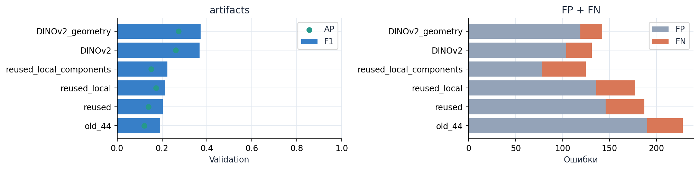

# AI Challenge 2026 — 3D Mesh Quality

Ищем дефекты 3D-моделей. У каждого объекта есть PNG с шестью ракурсами и NPZ с вершинами и гранями. Предсказываем 10 дефектов и качество объекта. Меток у одной модели может быть несколько.

## Идея

Сначала сравнили модели по картинкам и геометрии. Затем стали разбирать метки отдельно: что модель находит, что пропускает и какие признаки могут помочь.

Например, мало граней ещё не означает `lowpoly`: куб может быть нормальным, а сфера с тем же числом граней — угловатой. Для `noisy` смотрим неровность поверхности, для `artifacts` — локальные повреждения.

## Данные и метрика

Всего 8964 объекта: **6259 train / 1361 validation / 1344 internal test**. Модель и порог выбираем по validation. Test уже смотрели для simple, lowpoly и noisy, но пороги по нему не подбираем.

$$F1=\frac{2TP}{2TP+FP+FN}.$$

TP — найденные дефекты, FP — ложные срабатывания, FN — пропуски. Например, при TP = 30, FP = 10 и FN = 20 получим F1 = 0.67. Это пример расчёта, не результат модели.

Общая метрика соревнования:

$$score=10F1_{quality}+10F1_{defects,weighted}.$$

В таблице общих моделей показываем `score / 20`, то есть от 0 до 1.

## С чего начали

| Модель | Общий score, validation |
|---|---:|
| ResNet18 | .5539 |
| ResNet18 после улучшений | .5956 |
| PointNet++ | .3698 |
| CatBoost, 44 mesh-признака | .5518 |
| ResNet18 + CatBoost | **.6284** |

Старые опыты и EDA остались в `archive/`.

## По отдельным меткам

| Метка | Выбранный вариант | F1 validation | F1 test |
|---|---|---:|---:|
| [simple](labels/simple/README.md) | DINOv2 + прежняя связка | .7261 | .7223 |
| [lowpoly](labels/lowpoly/README.md) | DINOv2 + геометрия | .6383 | .6012 |
| [noisy](labels/noisy/README.md) | DINOv2 + геометрия | .8301 | .8385 |
| [artifacts](labels/artifacts/README.md) | DINOv2 + геометрия | .3717 | — |

Для `artifacts` проверили и MIL по отдельным участкам рендера. Attention дала F1 .3776 против .3717 у DINOv2 + геометрии, но AP ниже: .2372 против .2724. Разница по F1 маленькая, поэтому пока оставляем DINOv2 + геометрию. Результаты и карты внимания — в [ноутбуке](labels/artifacts/artifacts_mil.ipynb).

Ниже — сравнение моделей до MIL на validation. Слева F1 и AP, справа ложные срабатывания и пропуски.

Дальше переходим к `abstract`. Остальные метки пока проверены только в общей модели. DINOv3 для noisy не запустили: не получили доступ к весам. После большого числа опытов на одной validation небольшой прирост ещё нужно перепроверять.

---
---
---

