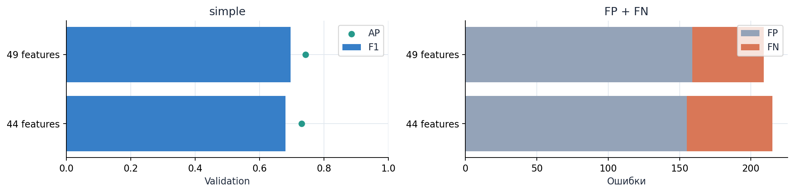
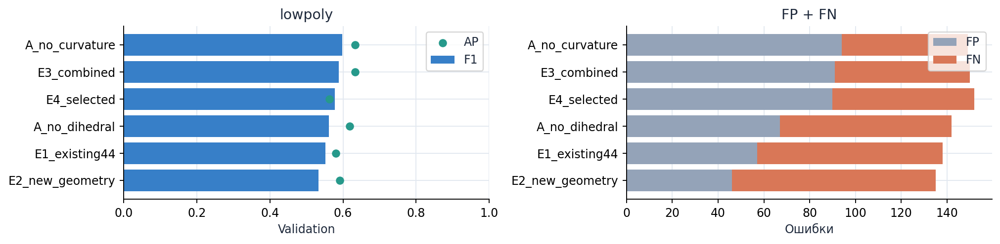
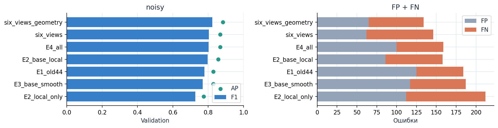
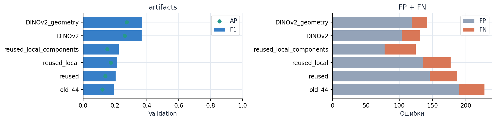
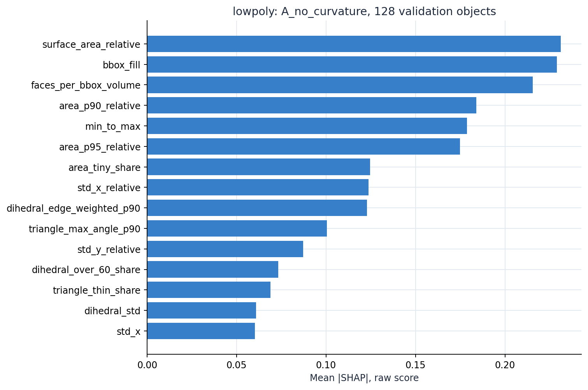
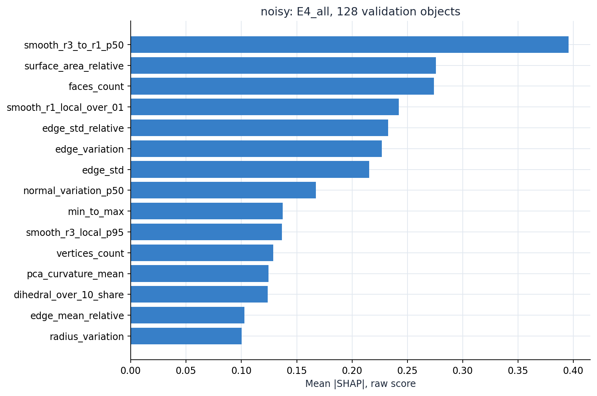
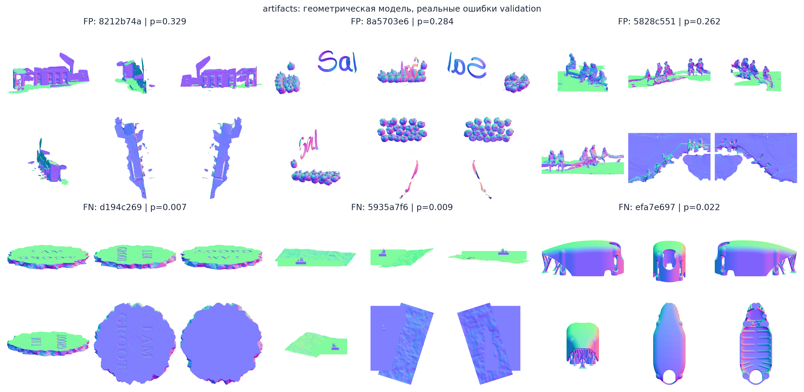
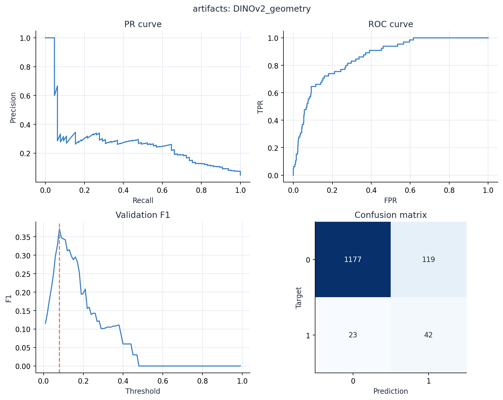

# Результаты и графики

[Общая таблица](results.csv) собирает сохранённые CSV и выводы ноутбуков. В каждой строке есть источник и split. Числа из notebook output могут быть округлены. [Проверенные метрики](verified_metrics.csv) заново рассчитаны по доступным вероятностям — без нового подбора порогов.

## Геометрия

Здесь показаны только результаты, для которых есть локальные вероятности. Это не полный список лучших моделей: исторические DINOv2 результаты lowpoly и noisy находятся в общей таблице и журналах.

## Какие признаки использует модель

SHAP рассчитан для сохранённых геометрических моделей на одних и тех же 128 validation-объектах. Это объяснение поведения моделей, а не новый опыт по выбору признаков.

| Метка | Среди важных признаков по mean absolute SHAP |
|---|---|
| simple | относительная толщина, faces/vertices, доля согласованных нормалей |
| lowpoly | относительная площадь, bbox_fill, плотность граней относительно bbox |
| noisy | отношение смещений после трёх и одного шагов сглаживания, площадь, число граней |
| artifacts | отношение смещений после сглаживания, отношение габаритов, bbox_fill |

Полный список — [feature_importance.csv](feature_importance.csv). Рядом сохранены корреляции самого важного признака с остальными на train. Высокая важность не доказывает причинную связь: геометрия может отражать тип объекта, а не сам дефект.

## Ошибки

Это ошибки геометрической модели artifacts, а не лучшей визуальной связки. В каждой миниатюре сохранены все шесть ракурсов. В строке FP — объекты без целевой метки, в FN — пропущенные положительные объекты. Аналогичные подборки есть для остальных трёх меток в `figures/`.

Здесь уже DINOv2 + геометрия: PR/ROC и confusion matrix рассчитаны по реальным сохранённым вероятностям validation. Вертикальная линия — прежний порог 0.08. Кривая F1 не использовалась для нового выбора порога.
