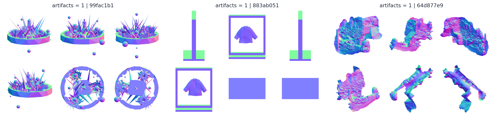
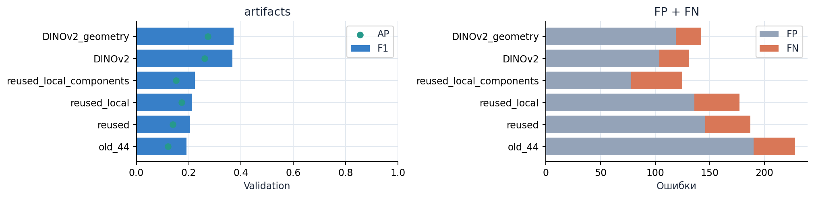
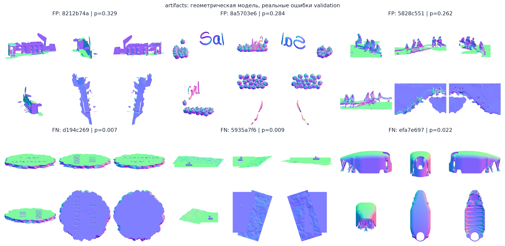

# artifacts

Странные переходы и сломанные участки поверхности. Сначала смотрим реальные примеры: часть похожих повреждений может относиться к noisy или intersection.

## Идеи

Длинное ребро среди коротких может указывать на вытянутый участок. Сравниваем его длину с медианами рёбер у двух концов:

$$r_{uv}=\frac{l_{uv}}{\max((m_u+m_v)/2,10^{-12})}.$$

Например, если ребро длиной 0.2, а обе медианы равны 0.05, получим $r=4$. Это повод присмотреться, а не готовое решение о дефекте.

Ещё проверили мелкие отдельные компоненты. Но отдельная часть может быть нормальной: например, мяч рядом с ракеткой.

Три объекта из train с этой меткой. У них могут быть и другие дефекты.

## Результаты

| Вариант | F1 validation | FP | FN |
|---|---:|---:|---:|
| Прежняя ResNet18 + CatBoost | .3153 | 106 | 33 |
| 44 mesh-признака | .1915 | 190 | 38 |
| Геометрия + локальные рёбра | .2133 | 136 | 41 |
| Ещё компоненты | .2236 | 78 | 47 |
| DINOv2 | .3671 | 104 | 27 |
| DINOv2 + геометрия | .3717 | 119 | 23 |
| MIL, Attention | **.3776** | 94 | 28 |
| MIL, 3-я эпоха по AP | .3363 | 123 | 27 |
| DINOv2 + геометрия, вес noisy ×2 | .3483 | 101 | 30 |
| DINOv2 + геометрия, вес noisy ×4 | .3103 | 82 | 38 |

Сравнение до MIL:

Изображения пока полезнее геометрии. Связка пропускает меньше дефектов, но чаще ошибается на объектах без artifacts. Среди её 119 ложных срабатываний 79 имеют метку noisy.

Ниже — ошибки геометрической модели с компонентами, сверху FP, снизу FN.

## MIL

В MIL вместо одного вектора картинки берём признаки отдельных участков. Небольшое повреждение может занимать лишь часть одного ракурса.

$$s=\sum_i\alpha_i s_i,\qquad \alpha_i=softmax(a_i).$$

Голова даёт участкам разные веса. Их можно показать поверх картинки, но это ещё не точная разметка дефекта. Примеры есть в [ноутбуке](artifacts_mil.ipynb).

Attention дала F1 **.3776** — на .0059 больше, чем DINOv2 + геометрия. Но AP ниже: **.2372 против .2724**. Выбор 3-й эпохи по AP поднял его до .2543, а F1 снизил до .3363. Пока оставляем DINOv2 + геометрию основным вариантом: прирост MIL по F1 слишком мал.

## Вес объектов с noisy

Увеличили вес объектов `artifacts=0, noisy=1` в train в 2 и 4 раза. Объекты с обеими метками остались положительными. Модель и признаки прежние.

F1 снизился до **.3483** и **.3103**. При весе 2 ложных срабатываний стало на 18 меньше, но пропусков — на 7 больше. AP тоже снизился: с .2724 до .2458. На объектах с обеими метками Recall упал с .7083 до .5833.

Вес всей группы noisy не помог. Поиск отдельных трудных примеров по ошибкам модели пока не проверяли. Графики и примеры — в [ноутбуке](artifacts_hard_negatives.ipynb).

Остальной код: `artifacts_examples.ipynb`, `artifacts_errors.ipynb`, `artifacts_geometry.ipynb`, `artifacts_dinov2.ipynb`. Разбиение — 6259 / 1361 / 1344, test ещё не оценивали. Подробности опытов — в [истории](../../docs/experiments/artifacts.md).
