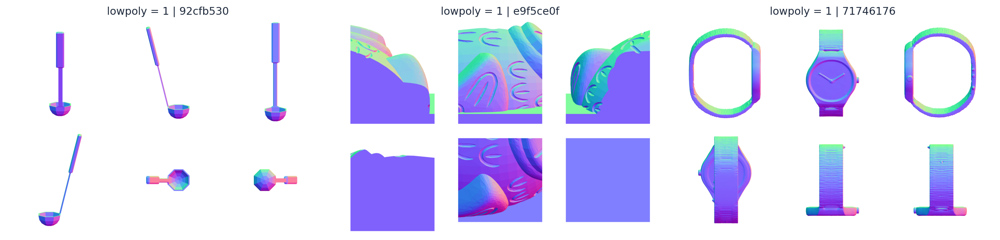
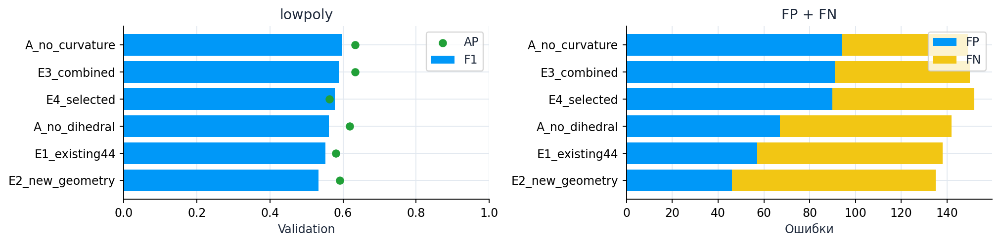
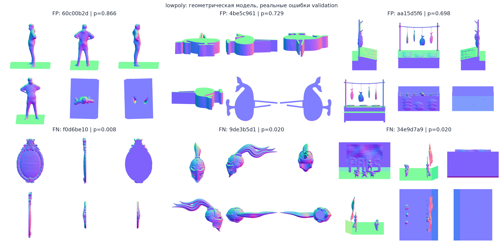

# lowpoly

Модели не хватает детализации: поверхность, которая должна быть гладкой, выглядит угловатой.

## Идея

Количество граней само по себе мало что говорит. Куб с 12 треугольниками может быть нормальным, а сфера — слишком грубой. Поэтому смотрим на форму треугольников и переходы между соседними гранями.

Для двух соседних граней считаем угол между нормалями:

$$\theta=\frac{180}{\pi}\arccos(|n_1\cdot n_2|).$$

У гладкого участка углы обычно меньше. В коде берём модуль, поэтому угол лежит от 0 до 90° и не замечает переворот нормали. Для больших мешей используем до 12000 граней: это оценка по части поверхности.

Три объекта из train с этой меткой. У них могут быть и другие дефекты.

## Результаты

| Вариант | F1 validation |
|---|---:|
| Прежняя ResNet18 + CatBoost | .5464 |
| 44 старых mesh-признака | .5519 |
| Старые + новые признаки | .5879 |
| Без приближённой кривизны | **.5984** |
| Без двугранных углов | .5617 |
| DINOv2 + геометрия | **.6383** |

Углы помогли, а приближённая кривизна в этом опыте — нет. Добавили признаки изображений и получили ещё +.0399 F1. На test выбранная связка дала **.6012**.

Ниже ошибки геометрической модели: сверху ложные срабатывания, снизу пропуски. Это не ошибки финальной связки с DINOv2.

Связка всё ещё часто пропускает смешанные случаи: на test пропущены 15 из 20 объектов `lowpoly + simple` и 12 из 14 `lowpoly + noisy`.

Код: `lowpoly_geometry.ipynb`, `lowpoly_dinov2.ipynb`, `lowpoly_dinov2_test.ipynb`. Данные: `../../data/`. Разбиение — 6259 / 1361 / 1344; пороги выбираем на validation. Остальные сравнения — в [истории](../../docs/experiments/lowpoly.md).
