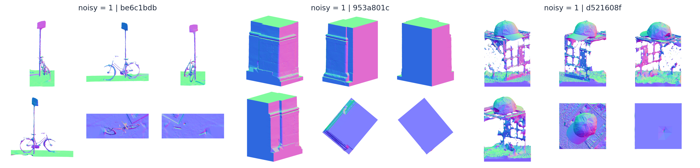
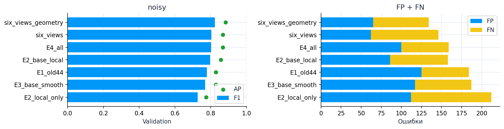
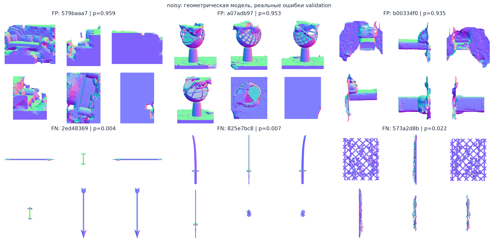

# noisy

Шумная поверхность: неровные точки и полигоны, часто после 3D-сканирования.

## Идея

Попробовали слегка сгладить меш и посмотреть, насколько сдвинутся вершины:

$$v^{k+1}=0.75v^k+0.25\operatorname{mean}_{u\in N(v)}u^k.$$

Вершина немного смещается к среднему положению соседей. Считаем смещения после одного и трёх шагов — $r_1$ и $r_3$, а также их отношение:

$$q=\frac{r_3}{\max(r_1,10^{-12})}.$$

Например, одиночный выступ и плавный изгиб могут по-разному реагировать на сглаживание. Но корректные острые детали тоже двигаются, поэтому решение принимает модель, а не правило по одному числу.

Три объекта из train с этой меткой. У них могут быть и другие дефекты.

## Результаты

| Вариант | F1 validation |
|---|---:|
| 44 mesh-признака | .7783 |
| Геометрия + локальные признаки + сглаживание | .8025 |
| DINOv2 mean/max | .8065 |
| DINOv2 + геометрия | **.8301** |
| Шесть ракурсов отдельно + геометрия | .8237 |

Шесть ракурсов без усреднения не помогли. Оставили DINOv2 + геометрию: **.8385 на test**. Только DINOv2 дал .8429 на test, но выбор по validation не меняем. DINOv3 не удалось запустить из-за доступа к весам.

Ошибки геометрической модели: сверху FP, снизу FN. Модель иногда путает шум с другими повреждениями.

Код: `noisy_geometry.ipynb`, `noisy_dinov2.ipynb`, `noisy_six_views.ipynb`, `noisy_dinov2_test.ipynb`. Данные: `../../data/`. Разбиение — 6259 / 1361 / 1344; пороги выбираем на validation. Полные таблицы — в [истории](../../docs/experiments/noisy.md).
