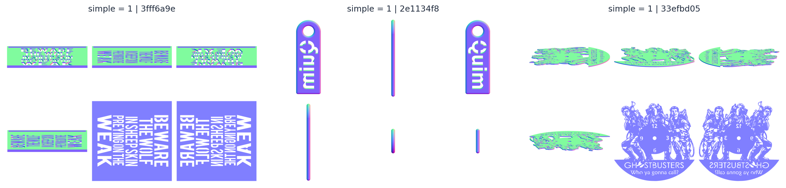
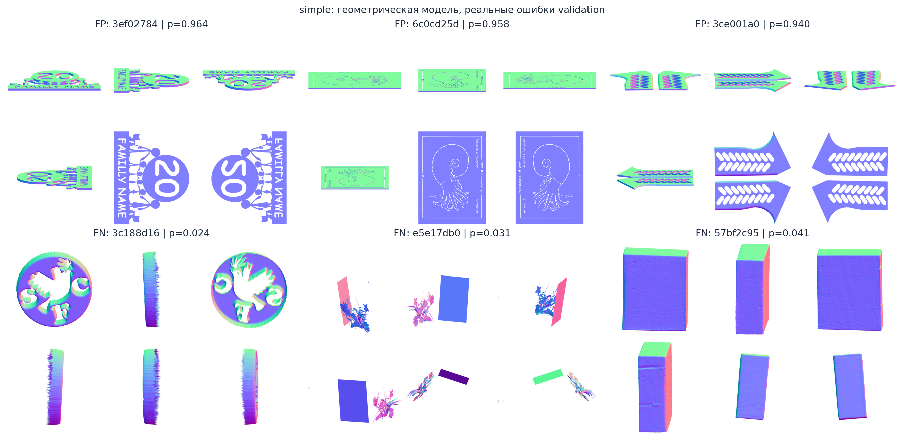

# simple

Слишком простые модели: примитивы, плоские объекты и выдавленные надписи.

## Что проверяли

Идея: простоту можно заметить по толщине и форме. Но выдавленный логотип может быть объёмным и содержать много граней, поэтому одного их количества мало.

Один из признаков — толщина по PCA:

$$t=\sqrt{\frac{\lambda_{min}}{\max(\lambda_{max},\varepsilon)}}.$$

Собственные значения описывают разброс вершин по трём главным направлениям. У тонкой пластины разброс по одному направлению маленький, поэтому и $t$ близко к нулю.

Три объекта из train с этой меткой. У них могут быть и другие дефекты.

## Что получилось

| Вариант | F1 validation |
|---|---:|
| CatBoost, 44 признака | .6805 |
| CatBoost, 49 признаков | .6958 |
| ResNet18 отдельно для simple | .7014 |
| Прежняя ResNet18 + CatBoost | .7090 |
| DINOv2 + прежняя связка | **.7261** |

В выбранной связке 75% вероятности DINOv2 и 25% прежней модели:

$$p=0.75p_{DINO}+0.25p_{old},\qquad \hat y=\mathbb{1}[p\ge0.35].$$

На test получилось **.7223**. Вариант DINOv2 с 49 mesh-признаками дал .7282, но после просмотра test выбор не меняем.

У CatBoost с 49 признаками осталось 50 пропусков вместо 60, а ложных срабатываний стало 159 вместо 155. Ниже примеры ошибок этой геометрической модели: сверху FP, снизу FN. В каждом PNG видны все шесть ракурсов.

Геометрия помогает, но не всегда передаёт смысл формы. Среди 60 прежних пропусков вручную нашли 28 выдавленных надписей и рельефов. Это наши заметки по изображениям, не отдельная разметка датасета.

Код: `simple.ipynb`, `simple_resnet.ipynb`, `simple_dinov2_comparison.ipynb`. Данные общие: `../../data/`. Разбиение — 6259 / 1361 / 1344; пороги выбираем на validation. Подробные опыты сохранены в [истории](../../docs/experiments/simple.md).
